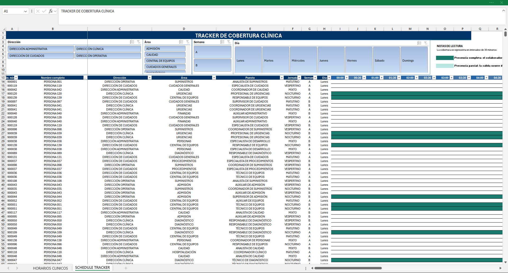

# Schedule Tracker: Workforce Scenarios 2026–2030

Interactive Excel model for visualizing workforce schedules, 24/7 operational coverage, shift handoffs, and progressive weekly-hour reduction scenarios using Power Query.

## Project overview

This project models the progressive transition of a synthetic workforce schedule toward a 40-hour workweek across five annual scenarios:

- **2026:** Baseline or AS IS scenario.
- **2027:** First schedule reduction.
- **2028:** Second schedule reduction.
- **2029:** Third schedule reduction and proportional adjustments.
- **2030:** Final scenario converging to 40 weekly hours.

The model combines structured Excel tables, Power Query transformations, formulas, conditional formatting, and interactive slicers.

## Key features

- 24/7 operational coverage.
- Rotating rest days across weeks A and B.
- Morning, evening, night, and administrative schedules.
- Overnight shifts that cross midnight.
- Shift overlaps for operational handoffs.
- Progressive annual schedule reductions.
- Automatic prevention of reductions below 40 weekly hours.
- 30-minute visualization intervals.
- Partial-interval highlighting for adjusted departure times.
- Interactive slicers by department, area, week, and day.
- Fully synthetic workforce data created for demonstration purposes.

## Scenario files

The complete Excel workbooks are available in the [`files`](files/) directory:

- [2026 baseline / AS IS](files/schedule-tracker-2026-as-is.xlsx)
- [2027 scenario](files/schedule-tracker-2027-scenario.xlsx)
- [2028 scenario](files/schedule-tracker-2028-scenario.xlsx)
- [2029 scenario](files/schedule-tracker-2029-scenario.xlsx)
- [2030 final 40-hour scenario](files/schedule-tracker-2030-40-hours.xlsx)

## Visualization guide

- **Dark teal:** Presence during the complete 30-minute interval.
- **Light teal:** Partial presence when the departure time occurs within the displayed interval.

Exact departure times remain available in the schedule data, while the tracker displays coverage in 30-minute blocks.

## Workbook architecture

Each workbook contains four functional layers:

1. **Clinical schedules:** Synthetic input data and annual schedule calculations.
2. **Power Query transformation:** Normalization of weekly and daily schedule records.
3. **Schedule base:** Technical table used by the visualization.
4. **Schedule Tracker:** Interactive timeline with slicers and conditional formatting.

The Power Query output and technical schedule base are hidden in the public workbooks to provide a cleaner user experience.

## How to use

1. Download one of the Excel workbooks from the [`files`](files/) directory.
2. Open the workbook in Microsoft Excel for Microsoft 365.
3. Navigate to the `SCHEDULE TRACKER` worksheet.
4. Use the slicers to filter by department, area, week, and day.
5. Review `HORARIOS CLINICOS` to inspect the synthetic schedules and annual calculations.

## Data privacy

All employee names, payroll identifiers, departments, areas, roles, and schedules contained in this repository are synthetic.

No personal, confidential, or company operational data is included.

## Methodological scope

The model visualizes workforce presence and operational coverage using entry and departure times.

The demonstration does not model:

- Meal-break deductions.
- Absenteeism or leave.
- Patient demand.
- Minimum staffing regulations.
- Clinical productivity.
- Labor-cost calculations.

The workbooks are intended as a workforce-planning and scenario-visualization prototype, not as a legal, payroll, or clinical staffing system.

## Tools used

- Microsoft Excel
- Power Query
- Structured tables
- Conditional formatting
- Interactive slicers
- Formula-based scenario calculations

## Author

Developed by Erick Aaron Luna Galaviz as a portfolio project focused on process analysis, workforce planning, and data visualization.

Usage and attribution
This repository is published for portfolio and demonstration purposes.

Copyright © 2026 Erick Aaron Luna Galaviz. All rights reserved.

No permission is granted to reproduce, modify, redistribute, sell, or present this project or its workbooks as original work without prior written authorization.

For permission requests, please contact the repository owner.
